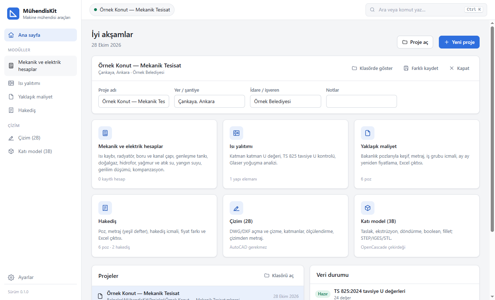
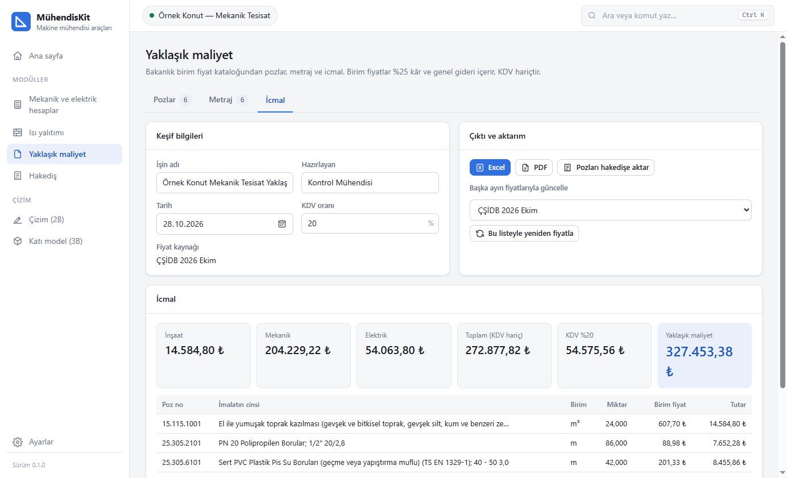
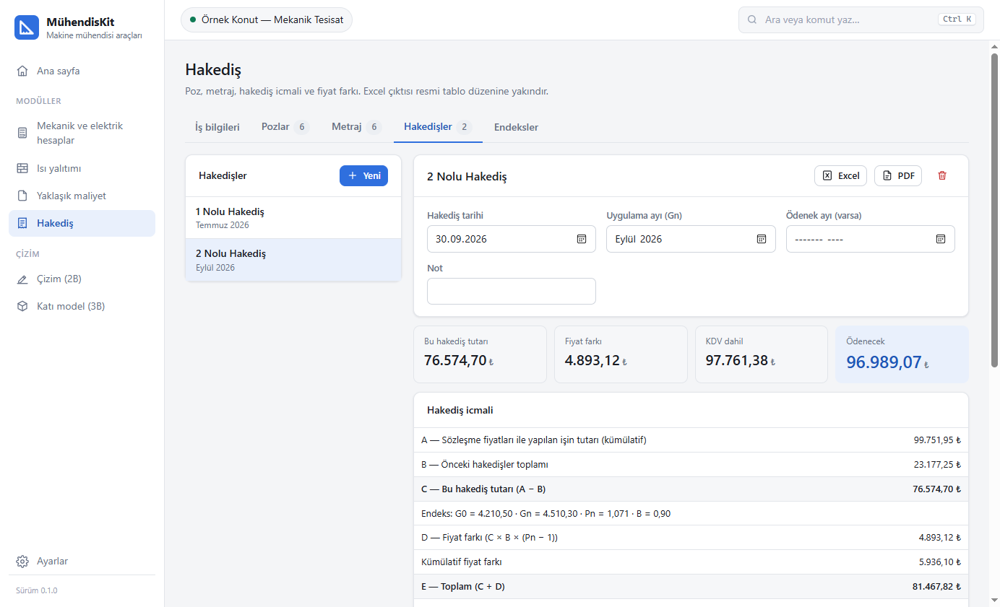
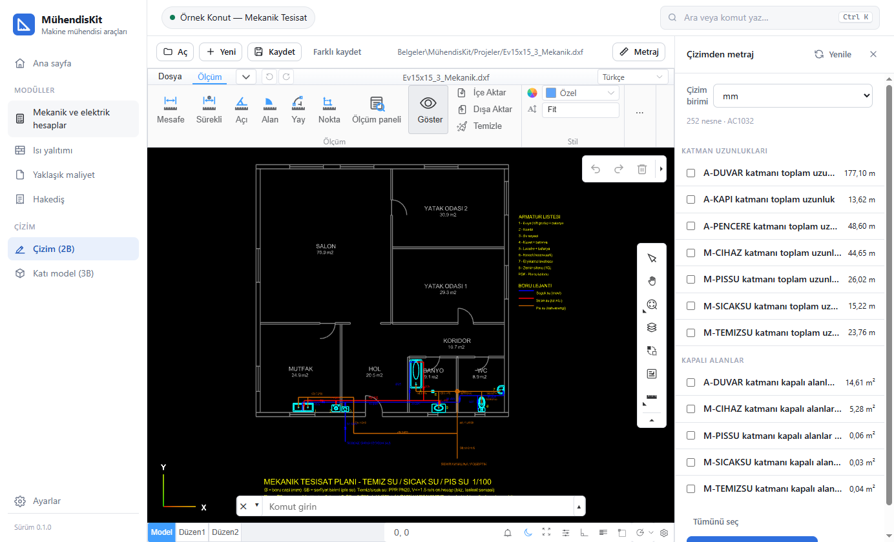
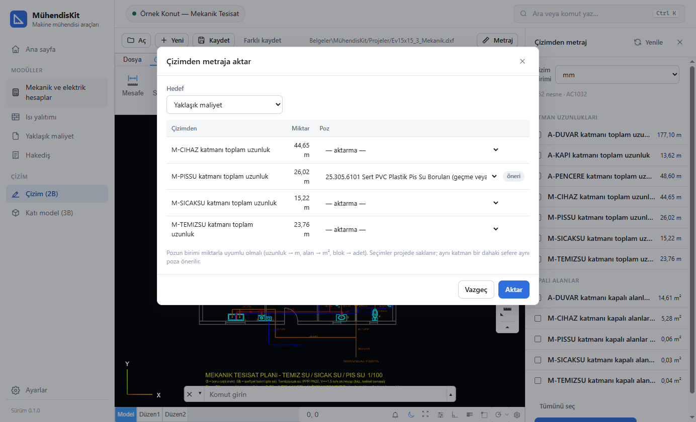
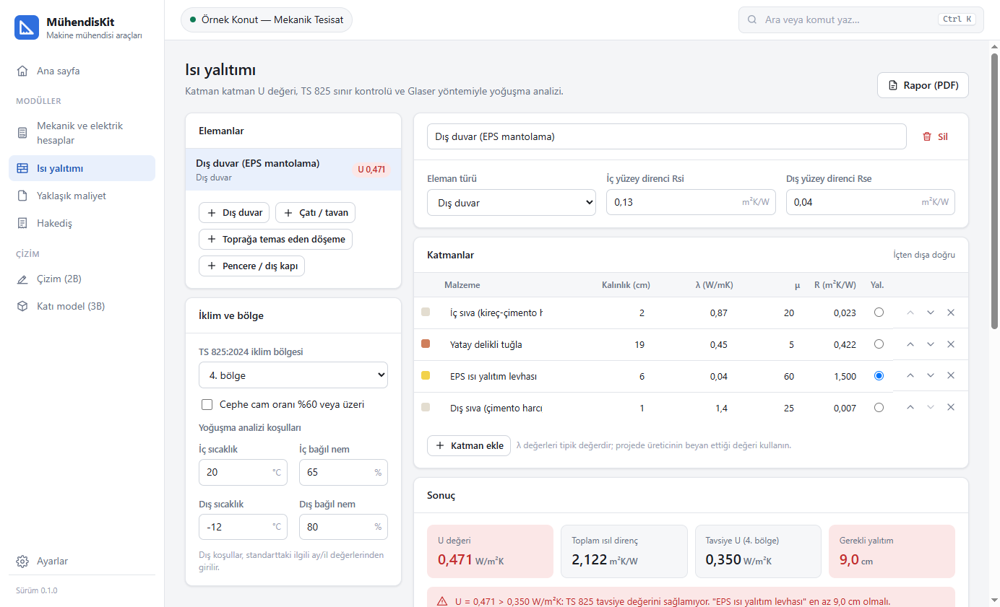
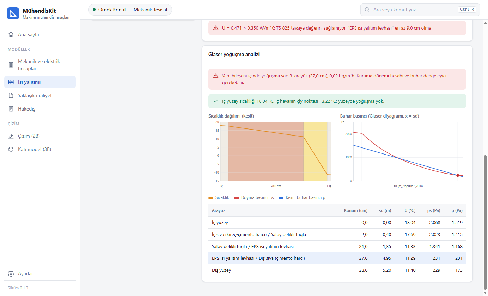
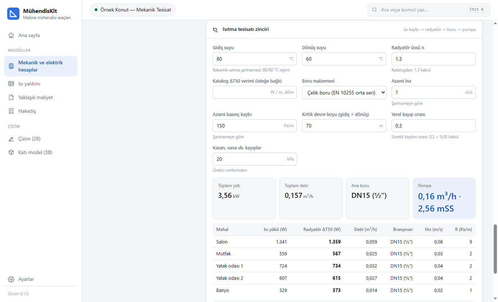
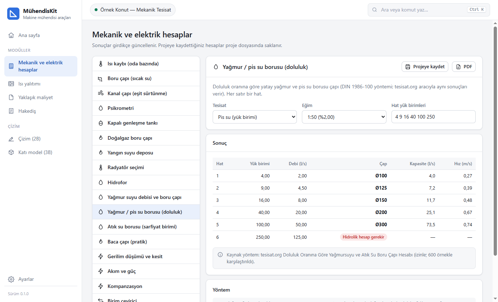

# MühendisKit

**Kontrol ve hakediş yapan Makine mühendisleri için hepsi bir arada Windows uygulaması.**
Mekanik ve elektrik hesapları, TS 825 ısı yalıtımı, Bakanlık birim fiyatlarıyla yaklaşık maliyet, hakediş, AutoCAD gerektirmeyen DWG/DXF editörü ve 3B katı modelleme tek pencerede. Uygulama Claude'a MCP sunucusu olarak bağlanır; Claude açık pencereyi kullanarak hesap yapar, çizer ve metraj çıkarır.



## Öne çıkanlar

- **Bakanlık birim fiyatları tek tıkla:** ÇŞİDB'nin yıllık kitabı ve aylık güncel listeleri indirilip okunur. İnşaat, mekanik ve elektrik pozları birim, fiyat, montaj bedeli ve tarifleriyle gelir. Yaklaşık 53.000 poz bağımsız bir PDF okuyucusuyla karşılaştırıldı; fiyat uyumsuzluğu çıkmadı.
- **Yaklaşık maliyet:** Pozlar katalogdan seçilir, metraj girilir. İnşaat, mekanik ve elektrik gruplarına ayrılmış icmal ve KDV hesaplanır. Keşif başka bir ayın fiyatlarıyla tek tıkla güncellenir; Excel ve PDF çıktısı alınır.
- **Çizimden metraja:** DWG/DXF'teki katman uzunlukları, kapalı alanlar ve blok adetleri pozlarla eşleştirilip yaklaşık maliyete ya da hakediş metrajına aktarılır. Eşleştirmeler hatırlanır; revize çizim tekrar aktarıldığında satırlar ikilenmez, güncellenir.
- **Hakediş:** Yeşil defter, dönem icmali, fiyat farkı (F = An × B × (Pn − 1)), TCMB EVDS'ten otomatik endeks, Excel çıktısı.
- **Isı kaybından pompaya:** Mahal ısı kayıpları hesaplanınca her mahalin radyatörü, branşman borusu, ana boru, pompa debisi ve basma yüksekliği arka arkaya çıkar. İl seçilince dış hesap sıcaklığı kendiliğinden gelir.
- **TS 825 ve Glaser:** Katman katman U değeri, tavsiye U kontrolü, gerekli yalıtım kalınlığı, yoğuşma analizi ve grafikleri.
- **Yönetmeliklerden hesaplar:** Yangın suyu deposu (Binaların Yangından Korunması Hakkında Yönetmelik), yağmur suyu (Yağmursuyu Yönetmeliği), hidrofor (Bakanlık Makina Tesisatı Genel Teknik Şartnamesi). Sonuçlarda dayanılan madde yazar.
- **Claude ile kullanım (MCP):** 32 araç (calculate aracında 18 hesap türü): hesaplar, poz arama, yaklaşık maliyet, hakediş, 2B çizim betikleri, 3B modelleme, ekran görüntüsü.

## Ekranlar

| | |
|---|---|
|  **Yaklaşık maliyet:** Bakanlık pozlarıyla keşif, iş grubu icmali, yeniden fiyatlama |  **Hakediş:** dönem icmali ve fiyat farkı |
|  **Çizim (2B):** DWG/DXF editörü ve çizimden metraj paneli |  **Poz eşleştirme:** katman adına ve birime göre öneri |
|  **Isı yalıtımı:** katmanlar, TS 825 kontrolü, gerekli kalınlık |  **Glaser:** sıcaklık ve buhar basıncı dağılımı |
|  **Isıtma zinciri:** radyatör, boru ve pompa |  **Hesaplar:** 17 mekanik ve elektrik hesap kartı |

## Modüller

| Modül | İçerik |
|---|---|
| **Mekanik ve elektrik hesaplar** | Isı kaybı (TS 2164 yapısı) ve ısıtma zinciri · radyatör seçimi (EN 442) · boru çapı (Darcy–Weisbach, Colebrook) · kanal çapı · psikrometri (ASHRAE) · genleşme tankı (TS EN 12828) · doğalgaz boru çapı (Renouard) · hidrofor · yağmur suyu debisi ve boru çapı · yağmur ve pis su borusu (doluluk oranı, DIN 1986-100) · atık su borusu (sarfiyat birimi) · pratik baca çapı · yangın suyu deposu · gerilim düşümü ve kesit · akım ve güç · kompanzasyon · birim çevirici |
| **Isı yalıtımı** | U değeri, TS 825:2024 tavsiye U kontrolü (cam oranı ≥ %60 kuralı dahil), gerekli yalıtım kalınlığı, Glaser yoğuşma analizi (TS EN ISO 13788), PDF rapor |
| **Yaklaşık maliyet** | Katalogdan poz, metraj cetveli, iş grubu icmali, KDV, ay ay yeniden fiyatlama, Excel/PDF, hakedişe aktarma |
| **Hakediş** | Poz listesi, yeşil defter, hakediş icmali, fiyat farkı, EVDS endeksleri, kesintiler, Excel/PDF |
| **Çizim (2B)** | DWG/DXF açma, çizme, ölçülendirme, DWG olarak kaydetme; çizimden metraj ve poz eşleştirme |
| **Katı model (3B)** | Taslak, ekstrüzyon, döndürme, süpürme, loft, boolean, radyüs/pah; STEP/IGES/BREP/STL |

## Kurulum

[Releases](../../releases/latest) sayfasından `MuhendisKit-Setup-<sürüm>.exe` dosyasını indirip çalıştırın. Windows 10 veya 11 (64 bit) gerekir; .NET kurmaya gerek yoktur.

- Paketin kod imzası olmadığı için Windows "Bilgisayarınız korundu" uyarısı verebilir: **Ek bilgi → Yine de çalıştır**.
- Kurulumda "Claude'a bağla" seçeneği işaretliyse MCP sunucusu Claude Code ve Claude Desktop'a kendiliğinden kaydedilir. Elle bağlamak için:

```
claude mcp add --scope user muhendiskit -- "C:\Program Files\MuhendisKit\MuhendisKit.Mcp.exe"
```

## Veri kaynakları ve izinler

Bu depo **özeldir**. Aşağıdaki veriler, sahiplerinin belediye içi ve ticari olmayan kullanım için verdiği izinle kullanılır; herkese açık dağıtım için ayrıca izin gerekir.

| Veri | Kaynak |
|---|---|
| Birim fiyatlar | ÇŞİDB Yüksek Fen Kurulu yıllık kitap ve aylık listeler (yfk.csb.gov.tr). Uygulama listeleri çalışırken indirir; depoda fiyat yoktur. |
| TS 825:2024 tavsiye U değerleri | TSE standardı; değerler belediyenin gösterdiği açık kaynak |
| İl iklim verileri, il yağış şiddetleri, doluluk oranına göre boru çapı yöntemi, atık su sarfiyat birimleri, pratik baca katsayıları | belediye açık kaynak |
| Yangın suyu, yağmur suyu, hidrofor ölçütleri | mevzuat.gov.tr ve Resmî Gazete yönetmelik metinleri, ÇŞİDB Makina Tesisatı Genel Teknik Şartnamesi |

Program standart değerlerini tahmin etmez. Kabul edilen değerler (ör. radyatör üssü n = 1,3) ekranda "kabul" olarak işaretlidir ve değiştirilebilir.

## Derleme

Gerekenler: .NET 10 SDK, Node.js 24, Git, Inno Setup 6 (kurulum paketi için).

```powershell
pwsh tools/build-web.ps1           # 2B (MLightCAD) ve 3B (Chili3D + overlay) modüllerini wwwroot'a derler
dotnet test                        # hesap motoru testleri (61 test)
dotnet build src/MuhendisKit       # uygulama + MCP sunucusu
pwsh installer/build.ps1 -SkipWeb  # dist/MuhendisKit-Setup-<sürüm>.exe
```

| Klasör | İçerik |
|---|---|
| `src/MuhendisKit` | WinForms + WebView2 kabuğu, arayüz (`wwwroot`) |
| `src/MuhendisKit.Core` | Hesap motoru: hesaplar, yalıtım, hakediş, yaklaşık maliyet, Bakanlık PDF okuyucusu, çizim analizi |
| `src/MuhendisKit.Mcp` | Claude için MCP sunucusu |
| `tests/MuhendisKit.Core.Tests` | xUnit testleri |
| `tools/cad2d`, `tools/cad3d` | 2B ve 3B editörlerin derleme düzenekleri |

## Lisans

MühendisKit, GNU Affero Genel Kamu Lisansı 3.0 (AGPL-3.0) ile lisanslanmıştır (bkz. `LICENSE`). Kullanılan bileşenler: MLightCAD (MIT), LibreDWG / libredwg-web (GPL-3.0), Chili3D (AGPL-3.0), Open CASCADE Technology (LGPL-2.1), ACadSharp (MIT), ClosedXML (MIT), PdfPig (Apache-2.0), three.js (MIT), Microsoft WebView2 SDK.
